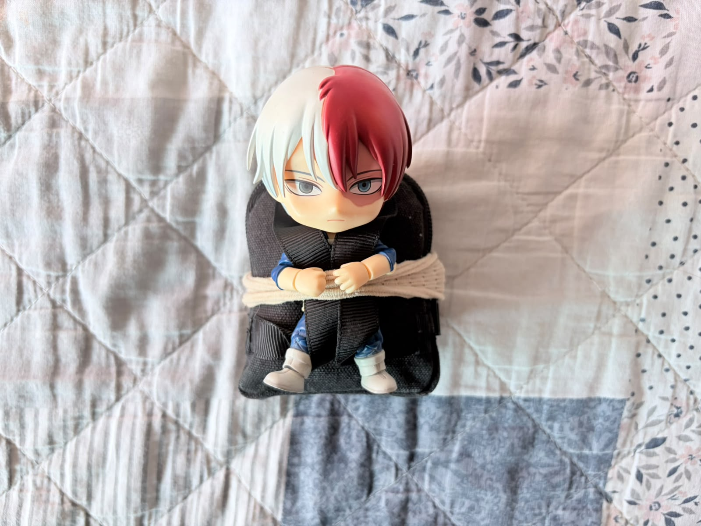
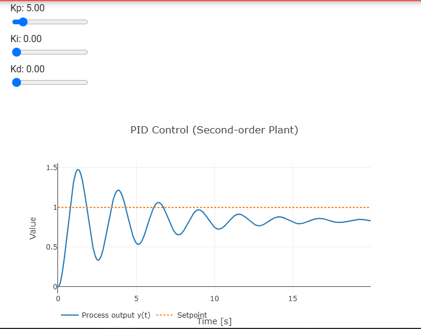
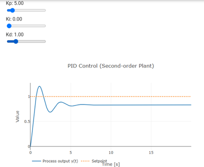

# Lazo abierto y lazo cerrado

## Objetivos
**Parte A · Lazo abierto con el carro**

- **Secuencia por tiempos con PWM fijo:** ✔️ <br>
    ◦ Se programó un avance recto de 3 s con PWM fijo (200 de 255).
- **Repetir en distintas condiciones:** ✔️ <br>
    ◦ Se probó en dos tipos de piso, con y sin carga, y se midió la distancia recorrida.
- **Tabla de datos:** ✔️ <br>
    ◦ Registro de las cuatro condiciones en una tabla de distancia recorrida.

**Parte B · Lazo cerrado con la demo**

- **Sintonización con la receta (P → D → I):** ✔️ <br>
    ◦ Se ajustó el controlador por prueba y error siguiendo ese orden.
- **Al menos dos juegos de ganancias con captura:** ✔️ <br>
    ◦ Intento 1 (solo P) e intento 2 (P + D), cada uno con su captura.
- **Medición de sobreimpulso, tiempo de establecimiento (±5 %) y error permanente:** ✔️
- **Elegir parámetros finales y justificarlos:** ✔️ <br>
    ◦ La justificación del ajuste se resume en Aprendizajes.


## Materiales
- (1×) Carro robot con ESP32 y driver de motores <br>
- (1×) Peso extra de 312.8 g <br>
- Dos tipos de piso para las pruebas <br>
- Computadora con navegador para la [demo de control PID](https://gulden8ag.github.io/Intro_mecatronica/M2_Control/tema7/) <br>


## Desarrollo

### Parte A · Lazo abierto con el carro

*Las fotos de esta parte son las mismas que las del equipo de Tania, ya que trabajamos juntos en esta práctica (solo en la parte A).* <br>

**Código** <br>
El código fue generado con IA. Hace avanzar el carro de forma recta durante 3 segundos con PWM fijo y luego lo detiene. <br>

```cpp
// --- Definición de Pines de tu Driver ---
const int STBY = 23;        // Pin Standby del driver

// Motor A
const int PWMA = 13;
const int AIN1 = 12;
const int AIN2 = 14;

// Motor B
const int PWMB = 25;
const int BIN1 = 27;
const int BIN2 = 26;

void setup() {
  Serial.begin(115200);

  // Configurar pines como salida
  pinMode(STBY, OUTPUT);
  pinMode(AIN1, OUTPUT);
  pinMode(AIN2, OUTPUT);
  pinMode(BIN1, OUTPUT);
  pinMode(BIN2, OUTPUT);

  // Activar el driver (sacarlo de standby)
  digitalWrite(STBY, HIGH);

  // Configurar PWM en el ESP32 (Frecuencia 1 kHz, resolución 8 bits)
  ledcAttachChannel(PWMA, 1000, 8, 0); // Canal 0
  ledcAttachChannel(PWMB, 1000, 8, 1); // Canal 1

  Serial.println("Iniciando prueba: Avanzando por 3 segundos...");

  // 1. Definir dirección de avance para ambos motores
  digitalWrite(AIN1, HIGH);
  digitalWrite(AIN2, LOW);
  digitalWrite(BIN1, HIGH);
  digitalWrite(BIN2, LOW);

  // 2. Enviar potencia PWM a los motores (velocidad 200 de 255)
  ledcWrite(PWMA, 200);
  ledcWrite(PWMB, 200);

  // 3. Mantener el movimiento exactamente durante 3000 ms (3 segundos)
  delay(3000);

  // 4. Detener los motores por completo
  ledcWrite(PWMA, 0);
  ledcWrite(PWMB, 0);
  digitalWrite(STBY, LOW); // Poner driver en modo paro

  Serial.println("¡Tiempo cumplido! Carro detenido.");
}

void loop() {
  // Se deja vacío para que la secuencia no se repita.
}
```

**Peso utilizado** <br>
{ width=50% } <br>
*Peso utilizado en las pruebas: 312.8 g* <br>

**Demostraciones en Video** <br>
[*Piso 1, sin peso*](./img_practica_7/1_piso.mp4) <br>
[*Piso 1, con peso*](./img_practica_7/1_piso_peso.mp4) <br>
[*Piso 2, sin peso*](./img_practica_7/2_piso.mp4) <br>
[*Piso 2, con peso*](./img_practica_7/2_piso_peso.mp4) <br>

**Resultados** <br>

| Condición | Intento | Distancia recorrida (cm) | Observaciones |
| :---: | :---: | :---: | :--- |
| **Piso 1 (liso), sin peso** | 1 | 108 | El carro se fue de lado porque la rueda loca no se mantenía en su lugar. |
| **Piso 1 (liso), con peso** | 2 | 96 | Avanzó más lento con el peso y también se desvió. |
| **Piso 2 (rocoso), sin peso** | 1 | 111 | La rueda loca siguió derecho gracias a las rocas. |
| **Piso 2 (rocoso), con peso** | 2 | 105 | Avanzó más lento con el peso. |

*Distancia recorrida por el carro en 3 s de avance, según el piso y la carga* <br>

**Explicación:**

* **Por qué distancia recorrida y no desviación:** En la tabla se usó la distancia recorrida total en lugar de la desviación del punto final, porque el carro se iba de lado: la rueda loca no se quedaba en su lugar y el primer piso era más resbaloso, así que se desviaba mucho.
* **Efecto del piso:** En el segundo piso las rocas hacían que la rueda loca siguiera su camino derecho, por lo que el carro llegó más lejos. Por esta razón no se puede hacer una comparación justa entre pisos, aunque sí se pudo evaluar lo ocurrido en cada uno.
* **Efecto del peso:** Lo que sí se observó claramente es que con peso el carro iba más lento.
* **Elección de los pisos:** Se evaluaron esos dos pisos porque eran los más opuestos que había disponibles en casa, sin un piso intermedio.

### Parte B · Lazo cerrado con la demo

**Capturas de la demo** <br>
{ width=50% } <br>
*Intento 1: Kp = 5, Ki = 0, Kd = 0* <br>

{ width=50% } <br>
*Intento 2: Kp = 5, Ki = 0, Kd = 1* <br>

**Resultados** <br>

| Intento | Kp | Ki | Kd | Sobreimpulso (%) | Tiempo de establecimiento (s) | Error permanente | Observación |
| :---: | :---: | :---: | :---: | :---: | :---: | :---: | :--- |
| **1** | 5 | 0 | 0 | 47 % | No se establece | 0.17 | Presenta oscilaciones grandes que disminuyen gradualmente. |
| **2** | 5 | 0 | 1 | 20 % | No se establece | 0.17 | La acción derivativa reduce las oscilaciones y mejora la estabilidad. |

*Sobreimpulso, tiempo de establecimiento (banda de ±5 %) y error permanente de cada juego de ganancias* <br>

**Explicación:**

* **Intento 1 (solo P):** La respuesta es oscilatoria y con un sobreimpulso elevado, de alrededor de 47 %.
* **Intento 2 (P + D):** Al agregar la ganancia derivativa Kd = 1, las oscilaciones disminuyen considerablemente (sobreimpulso de 20 %) y la respuesta se vuelve más estable.
* **Error permanente:** En ambos intentos el sistema mantiene un error permanente de aproximadamente 0.17, porque todavía no se usa la acción integral.
* **Cálculo del error permanente:** Se obtiene con **e_ss = r − y_ss**, donde **r = 1** es la referencia y **y_ss ≈ 0.83** es el valor final de la salida. Entonces: **e_ss = 1 − 0.83 ≈ 0.17**.

## Fallas
- **Síntoma:** En lazo abierto el carro no avanzaba recto, se iba de lado, sobre todo en el primer piso.
- **Cómo lo encontré:** Al repetir las pruebas se notó que la rueda loca no se quedaba en su lugar, y que el piso más resbaloso empeoraba la desviación.
- **Solución:** Como la desviación no se podía medir de forma consistente, se registró la distancia recorrida total y se analizaron las diferencias entre condiciones de forma cualitativa.

## Aprendizajes
En la Parte A se observó que un lazo abierto no corrige nada por sí solo: el resultado depende del piso y de la carga, y con peso el carro avanzó más lento. En la Parte B se realizó la sintonización del controlador PID mediante prueba y error. Primero se utilizó únicamente la acción proporcional, observando que el sistema presentaba oscilaciones y un error permanente. Después se agregó la acción derivativa para disminuir las oscilaciones y mejorar la estabilidad de la respuesta. Finalmente, se incorporó la acción integral para reducir el error permanente.

Se observó que cada componente del controlador influye de manera diferente en el comportamiento del sistema. El objetivo del ajuste final fue encontrar un equilibrio entre rapidez, estabilidad y precisión, buscando obtener un sobreimpulso menor al 5 % y un tiempo de establecimiento menor a 5 segundos.

## Siguiente paso
Como siguiente paso, se buscará aplicar el control en lazo cerrado al carro físico, para que pueda corregir la desviación que se observó en lazo abierto.
