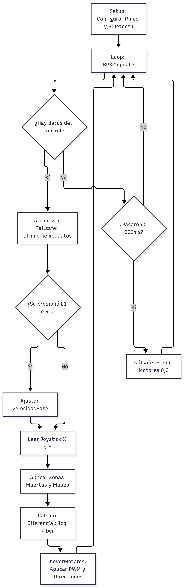
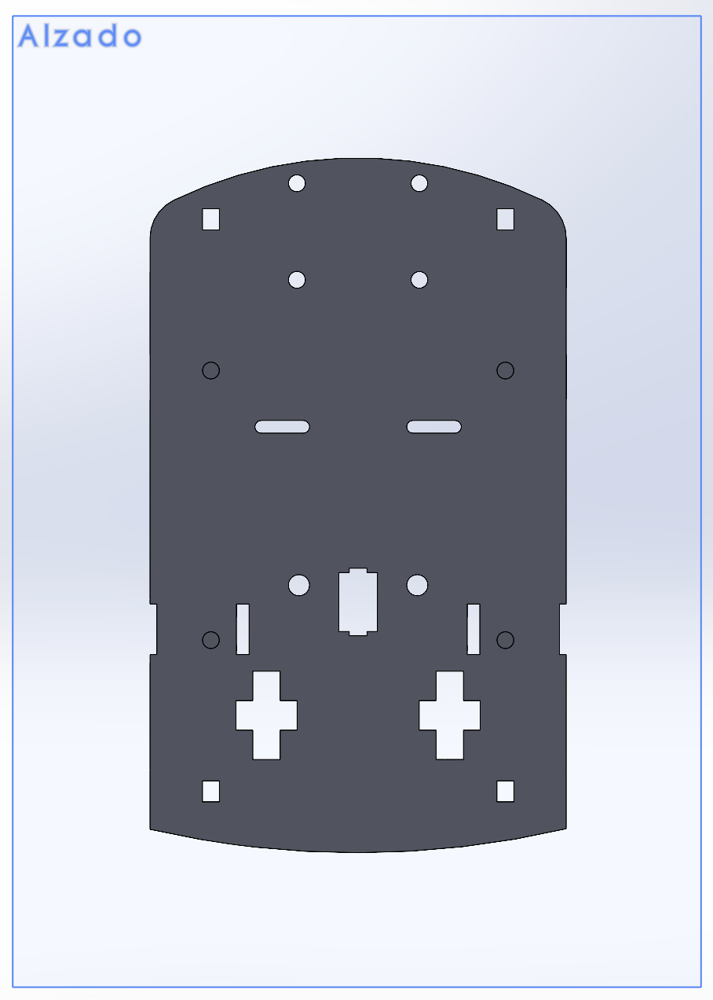
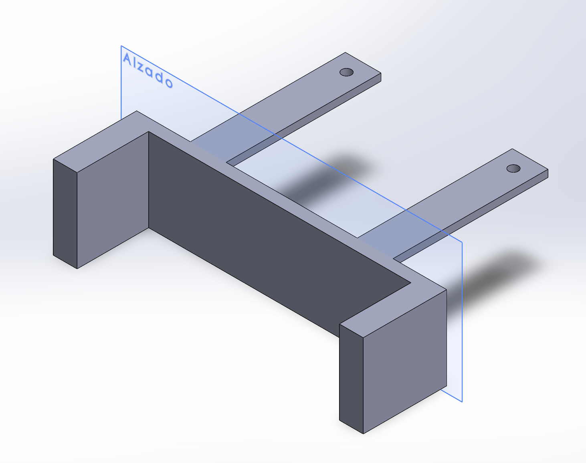
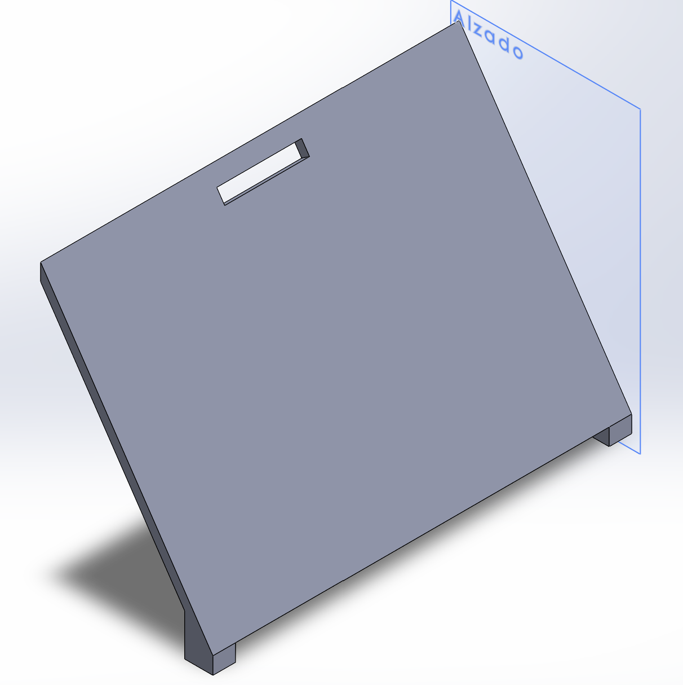
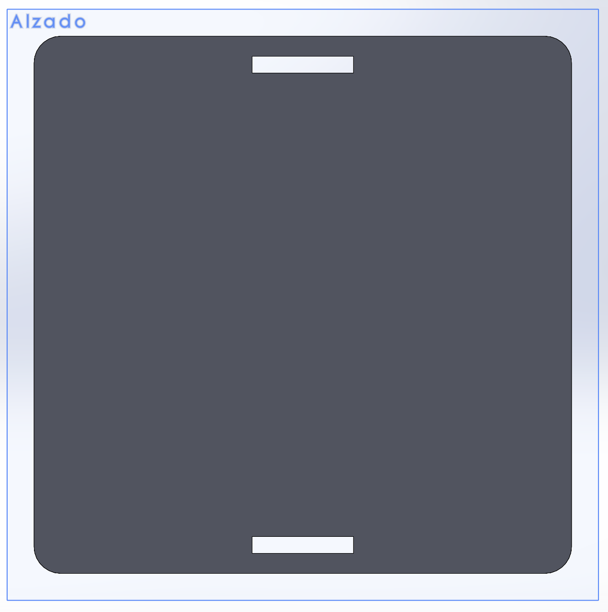
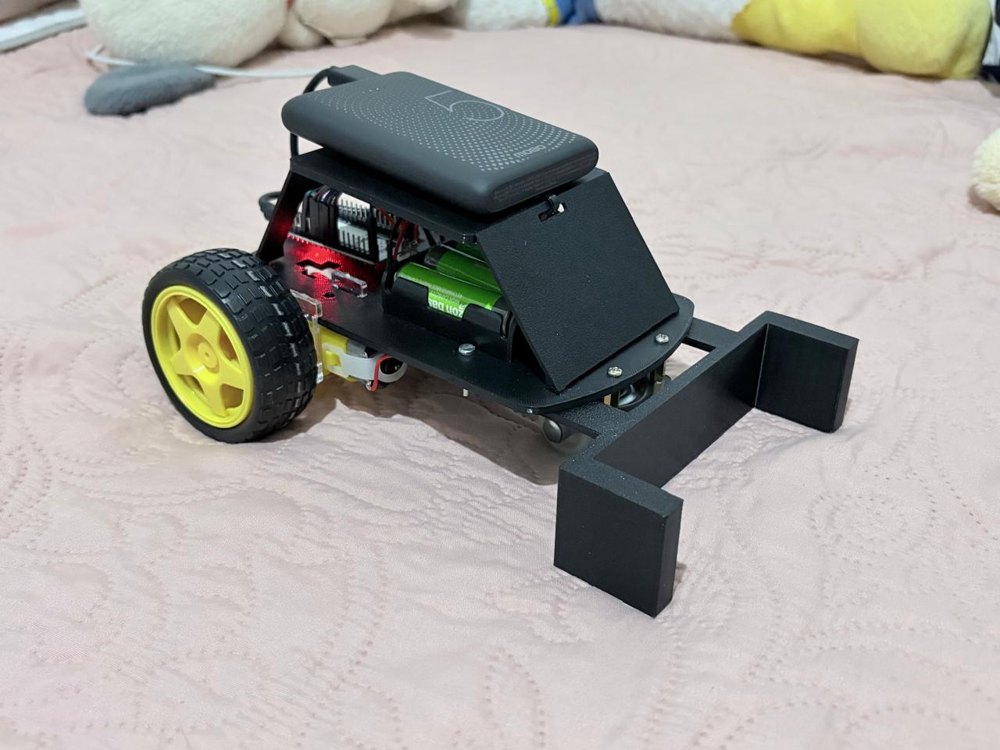

# Robot Móvil Diferencial con ESP32

> *Octubre 2 de 2026*  

## Objetivo
Fabricar, diseñar y programar un carro utilizando un ESP32 controlado por Bluetooth desde un dispositivo (celular o computadora). Al final, se demostrará su funcionamiento en un torneo de fútbol 1v1 contra los demás proyectos.

---

## Requisitos

### Funcionales
- El carro se mueve adelante, atrás, izquierda, derecha y alto por comandos Bluetooth.
- Control de velocidad por PWM (mínimo 3 niveles o velocidad proporcional).
- El protocolo de comandos está documentado en el portafolio (qué comando hace qué).
- Failsafe: si se pierde el enlace o no llegan comandos en ≤1 s, el carro se detiene solo.                 
- Interruptor físico de encendido/apagado accesible sin desarmar nada.
- Alimentación de motores separada del ESP32 (con GND común), como se vio en el tema de Actuadores.
- Cableado ordenado y sujeto: nada de cables sueltos arrastrando.
- Superficie plana horizontal de al menos 6 × 6 cm en la parte superior, despejada: ahí vivirá el marcador ArUco del Proyecto Final.

### Propios
- Que tenga 4 llantas.
- Que tenga un capote completo.
- Utilizar un puente L289N.
- Que tenga unas pinzas para empujar la pelota.
- Controlarlo con un control de Xbox.

---

## Arquitectura

{ width=50% } <br>
*Lectura del control con Bluepad32, cálculo de la velocidad de cada motor con el joystick y failsafe que detiene el carro tras 500 ms sin datos* <br>

---

## Plan por semanas
- **Semana 1:** Modelado del chasis en SolidWorks, a partir de un kit para visualizar mejor los componentes y la estructura. Soldado de los cables a los motores, y montaje de las ruedas y el switch para asegurar su funcionamiento.  
- **Semana 2:** Impresión 3D del chasis y del capote para agregar el cuadrado de 6 × 6 cm. Programación del control por Bluetooth para validar su funcionamiento por medio de un control.

---

## Criterios de éxito
- Cumplir los 8 requisitos funcionales.
- Tener un failsafe donde el carro se detenga al no recibir indicaciones.
- Entregar el repositorio en tiempo y forma.
- Lograr controlar el carro por medio de un control de Xbox.

---

## Boceto del chasis

{ width=50% } { width=50% } <br>
{ width=50% } { width=50% } <br>


## BOM

| Componente | Cantidad | Costo |
|---|---|---|
| Batería portátil | 1 pza | $300.00 |
| Termofil 1/16 | 1 metro | $10.00 |
| Jumper hembra-hembra | 1 pza | $38.00 |
| Llantas | 2 pzas | $70.00 |
| Mini switch 3 patas | 1 pza | $15.00 |
| Cinchos negros | 1 paquete | $34.00 |
| Cable negro y rojo | 3 m | $30.00 |
| Tornillos | 1 paquete | $25.00 |

---

## Análisis de riesgos
- Que la soldadura se rompa 
- No se conecte el Bluetooth al ESP32
- Existan cables sueltos que se atoren con las ruedas
- Descarga de las pilas por exceso de consumo
- Fallar al intentar conectar 4 llantas a 2 motores

---

> *Octubre 9 de 2026*

## Bitácora de fallas

| ¿Qué falló? | ¿Cómo lo encontraron? | ¿Cómo lo resolvieron? |
|---|---|---|
| Las medidas del chasis | Midiendo para corroborar que se cumplían las especificaciones | Rediseñando la pieza y volviendo a imprimir |
| Idea principal de 4 llantas | Descubrimos que era un motor por llanta, por lo que se descartó la idea de las 4 llantas | Agregamos una rueda loca para que el carro tenga soporte |
| Descarga de las pilas | Los motores consumían más corriente que el ESP32, por lo que las pilas se agotaban muy rápido | Utilizando dos fuentes de alimentación diferentes |
| Diseño de las pinzas (empujar la pelota) | Nos comentaron que no era posible nuestra idea porque retenía la pelota | Lo cambiamos por un cuadrado para avanzar con la pelota |
| Biblioteca para el control | Al buscarla en el Gestor de bibliotecas del Arduino IDE aparecía otra librería con nombre parecido, y el ESP32 no la reconocía. Investigamos y vimos que, para el ESP32, Bluepad32 no se instala como librería sino como paquete de placa. | Agregamos las URLs del paquete de ESP32 y del paquete Bluepad32 en las Preferencias del IDE, instalamos esp32 y esp32_bluepad32 desde el Gestor de tarjetas y seleccionamos la placa "Bluepad32_ESP32”. |  

---

> *Octubre 16 de 2026*

## Readme

### Configuración de Bluepad32 para Control Inalámbrico 
Para usar el control de Nintendo Switch Joy-Con / Xbox con el ESP32, se configuraron las siguientes URLs adicionales en las preferencias del IDE de Arduino:  

`https://raw.githubusercontent.com/espressif/arduino-esp32/gh-pages/package_esp32_index.json`

`https://raw.githubusercontent.com/ricardoquesada/esp32-arduino-lib-builder/master/bluepad32_files/package_esp32_bluepad32_index.json`

### Protocolo de Comandos
- **Joystick Analógico (Eje Y):** Controla hacia adelantes y atras (zona muerta digital de 35 unidades)
- **Joystick Analógico (Eje X):** Controla izquierda y derecha
- **Botones L1 / R1 (SL / SR):** Disminuyen o aumentan la velocidad base en pasos de 15 unidades (Rango: 60 a 255)

### Esquemático

[*Esquematico*](./img_proyecto_1/esquematico.mp4) <br>

En este video se muestra la simulación del circuito del carro en Wokwi. Como Wokwi no tiene un puente H ni motores DC entre sus componentes, se utilizo un chip personalizado creado con código por la comunidad, que representa al driver TB6612FNG, un puente H doble. Cada motor está representado con dos LEDs: el verde prende cuando gira hacia adelante y el rojo cuando gira hacia atrás. Al correr la simulación, el programa mueve cada motor por separado, luego los dos juntos y al final hace los giros, y en el monitor serial se ve qué movimiento está haciendo.

### Código 

```c
#include <Arduino.h>
#include <Bluepad32.h>

// ==========================================
// 1. VARIABLES Y PROTOTIPOS
// ==========================================
void processGamepad(ControllerPtr ctl);
void moverMotores(int izq, int der);
void processControllers();

// Arreglo para guardar el control conectado
ControllerPtr myControllers[BP32_MAX_GAMEPADS];

// Control de seguridad (Failsafe): Guarda el tiempo en milisegundos del último paquete recibido
unsigned long ultimoTiempoDatos = 0;
const unsigned long TIMEOUT_FAILSAFE = 500; // Si pasan más de 500ms sin datos, frena por seguridad

// ==========================================
// 2. PINES DEL DRIVER DE MOTORES (TB6612FNG)
// ==========================================
const int PIN_STBY = 23; // Encendido general del driver
const int PWMA = 13;     // Velocidad motor izquierdo
const int AIN1 = 12;     // Dirección motor izquierdo A
const int AIN2 = 14;     // Dirección motor izquierdo B
const int PWMB = 25;     // Velocidad motor derecho
const int BIN1 = 27;     // Dirección motor derecho A
const int BIN2 = 26;     // Dirección motor derecho B

int velocidadBase = 150; // Velocidad inicial (de 0 a 255)

// ==========================================
// 3. CONEXIÓN Y DESCONEXIÓN BLUETOOTH
// ==========================================
void onConnectedController(ControllerPtr ctl) {
    for (int i = 0; i < BP32_MAX_GAMEPADS; i++) {
        if (myControllers[i] == nullptr) {
            Serial.printf("Control conectado en ranura %d\n", i);
            myControllers[i] = ctl;
            break;
        }
    }
}

void onDisconnectedController(ControllerPtr ctl) {
    for (int i = 0; i < BP32_MAX_GAMEPADS; i++) {
        if (myControllers[i] == ctl) {
            Serial.printf("Control desconectado de ranura %d\n", i);
            myControllers[i] = nullptr;
            moverMotores(0, 0); // Frena de golpe si se desconecta
            break;
        }
    }
}

// ==========================================
// 4. CONTROL DE MOTORES
// ==========================================
void moverMotores(int velIzq, int velDer) {
    digitalWrite(PIN_STBY, HIGH); // Activar driver

    // Motor Izquierdo
    velIzq = -velIzq;
    if (velIzq > 0) {
        digitalWrite(AIN1, HIGH);
        digitalWrite(AIN2, LOW);
    } else if (velIzq < 0) {
        digitalWrite(AIN1, LOW);
        digitalWrite(AIN2, HIGH);
        velIzq = -velIzq;
    } else {
        digitalWrite(AIN1, LOW);
        digitalWrite(AIN2, LOW);
    }
    analogWrite(PWMA, constrain(velIzq, 0, 255));

    // Motor Derecho
    velDer = -velDer;
    if (velDer > 0) {
        digitalWrite(BIN1, HIGH);
        digitalWrite(BIN2, LOW);
    } else if (velDer < 0) {
        digitalWrite(BIN1, LOW);
        digitalWrite(BIN2, HIGH);
        velDer = -velDer;
    } else {
        digitalWrite(BIN1, LOW);
        digitalWrite(BIN2, LOW);
    }
    analogWrite(PWMB, constrain(velDer, 0, 255));
}

// ==========================================
// 5. LECTURA DEL JOY-CON IZQUIERDO
// ==========================================
void processGamepad(ControllerPtr ctl) {
    // Actualizamos el cronómetro del failsafe porque sí hay señal activa
    ultimoTiempoDatos = millis();

    // Botones L1 (SL) y R1 (SR) para cambiar velocidad en caliente
    if (ctl->l1()) { 
        velocidadBase = max(60, velocidadBase - 15);
        Serial.printf("Velocidad baja: %d\n", velocidadBase);
        delay(200); 
    }
    if (ctl->r1()) { 
        velocidadBase = min(255, velocidadBase + 15);
        Serial.printf("Velocidad alta: %d\n", velocidadBase);
        delay(200);
    }

    // Leer los ejes del joystick
    int joystickY = ctl->axisY(); 
    int joystickX = ctl->axisX(); 

    // Zona muerta para que no se mueva solo por vibración o juego del dedo
    if (abs(joystickY) < 35) joystickY = 0;
    if (abs(joystickX) < 35) joystickX = 0;

    // Calcular la mezcla para avance y giros
    int potenciaEje = map(joystickY, -511, 512, -velocidadBase, velocidadBase);
    int giroEje = map(joystickX, -511, 512, -velocidadBase / 2, velocidadBase / 2);

    int motorIzq = potenciaEje + giroEje;
    int motorDer = potenciaEje - giroEje;

    moverMotores(motorIzq, motorDer);
}

void processControllers() {
    bool controlActivo = false;
    for (auto myController : myControllers) {
        if (myController && myController->isConnected() && myController->hasData()) {
            controlActivo = true;
            if (myController->isGamepad()) {
                processGamepad(myController);
            }
        }
    }

    // SISTEMA FAILSAFE: Si el control estaba conectado pero deja de mandar datos de golpe
    if (controlActivo == false) {
        if (millis() - ultimoTiempoDatos > TIMEOUT_FAILSAFE) {
            moverMotores(0, 0); // Corta motores por seguridad
        }
    }
}

// ==========================================
// 6. CONFIGURACIÓN INICIAL
// ==========================================
void setup() {
    Serial.begin(115200);
    
    // Configurar pines de los motores como salidas
    pinMode(PIN_STBY, OUTPUT);
    pinMode(PWMA, OUTPUT);
    pinMode(AIN1, OUTPUT);
    pinMode(AIN2, OUTPUT);
    pinMode(PWMB, OUTPUT);
    pinMode(BIN1, OUTPUT);
    pinMode(BIN2, OUTPUT);

    digitalWrite(PIN_STBY, HIGH);

    // Arrancar Bluetooth
    BP32.setup(&onConnectedController, &onDisconnectedController);
    BP32.enableVirtualDevice(false);
    
    ultimoTiempoDatos = millis(); // Inicializar cronómetro
}

// ==========================================
// 7. BUCLE PRINCIPAL
// ==========================================
void loop() {
    bool dataUpdated = BP32.update();
    if (dataUpdated) {
        processControllers();
    } else {
        // Si el ciclo pasa y no hay datos nuevos, evaluamos el failsafe por tiempo
        if (millis() - ultimoTiempoDatos > TIMEOUT_FAILSAFE) {
            moverMotores(0, 0);
        }
    }

    delay(20);
}
```
**Codigo hecho con Gemini y un ejemplo directo de Arduino IDE**

## Video de demostración

[*Demostración del funcionamiento 1*](./img_proyecto_1/funcionamiento1.mp4) <br>
[*Demostración del funcionamiento 2*](./img_proyecto_1/funcionamiento2.mp4) <br>

## Requisitos vs. resultados
 
| # | Requisito | ¿Se cumple? |
|---|---|---|
| 1 | Movimiento adelante, atrás, izquierda, derecha y alto por Bluetooth | Sí |
| 2 | Control de velocidad por PWM, mínimo 3 niveles | Sí |
| 3 | Protocolo de comandos documentado | Sí |
| 4 | Failsafe: el carro se detiene si no llegan comandos en 1 s o menos | Sí |
| 5 | Interruptor físico accesible sin desarmar | Sí |
| 6 | Alimentación de motores separada del ESP32, con GND común | Sí |
| 7 | Cableado ordenado y sujeto | Sí |
| 8 | Superficie plana horizontal de al menos 6 × 6 cm en la parte superior | Sí |
 
## Lecciones aprendidas
 
1. *La alimentación de los motores y la del ESP32 deben ser independientes*  
   Al conectar los motores y el ESP32 a las mismas pilas, la batería se agotaba muy rápido. Aprendimos que los motores consumen mucha más corriente que el microcontrolador y que cada subsistema necesita su propia fuente.
2. *Partir de algo físico facilita y acelera el modelado en CAD*  
   Compramos un kit de carrito para visualizar la estructura, y con ese modelo tangible como referencia modelamos nuestro chasis en SolidWorks. Aprendimos que tener las medidas y la forma de los componentes a la mano reduce errores y ahorra tiempo en el diseño.
3. *Planear y respetar los tiempos deja margen para corregir*  
   Tuvimos fallas al imprimir, y logramos arreglarlas porque aún había tiempo para reimprimir y ajustar. Por eso, realizar el proyecto en tiempo ayuda a que se puedan resolver estos errores sin prisa. Aprendimos que los proyectos requieren tiempo para solucionar estos errores y solo se pueden solucionar si se trabaja con anticipación.
4. *El switch debe cortar la línea positiva de la alimentación y ser accesible.*  
   Aprendimos que un interruptor funciona abriendo o cerrando el camino de la corriente, por lo que se conecta en serie con el cable positivo de la batería, usando la pata central y una lateral. También vimos que debe soportar la corriente del circuito y colocarse en un lugar accesible, para poder apagar el carro rápidamente sin desarmarlo.

<br>

## Resultado Final

{ width=70% } <br>
*Carrito final todo armado con chasis y alimentado correctamente* <br>

